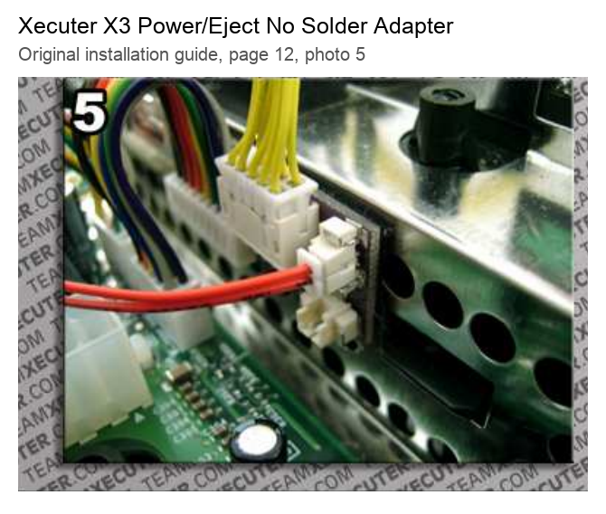

<!-- SPDX-License-Identifier: Apache-2.0 -->
# Build request: plug-in Xbox power-button adapter

I would like to pay someone to build a small adapter for my original Xbox
(revision 1.4). My goal is to turn it back on remotely after a hard freeze and
an AC power cycle, without soldering or cutting any original Xbox wiring.

## What it should look like

```text
Xbox motherboard       NEW plug-in adapter       Original front-panel cable
     connector  ------> [pass-through] ---------> POWER / EJECT / LEDs
                              |
                              +---- two-wire lead ----> external relay
                                                        (NO + COM)
```

The adapter plugs between the motherboard and the existing front-panel cable.
The original buttons and LEDs keep working. The extra two-wire lead lets an
external relay briefly close the same circuit as the physical POWER button.

## Example: the old Xecuter adapter

Something like the **[Xecuter X3 Power/Eject No Solder Adapter, shown on page 12
of this guide](https://connortumbleson.com/uploads/2024/03/x3_ce_v10_v16.pdf#page=12)**,
but with a two-wire POWER-only connection for our relay.



This is a historical example, not a photo or verified pinout of the new adapter.

## What I need you to supply

- A fully assembled, insulated plug-in adapter that preserves all original
  front-panel connections.
- A labeled two-wire POWER/return lead with a keyed disconnect, including both
  connector halves. Please quote about 0.5 m of usable cable.
- Relay-end wires labeled **NO / POWER** and **COM / Xbox return**.
- A checked wiring map, clear connector-orientation photos and simple
  installation instructions.

Please verify the connector fit and identify POWER/return by continuity to the
actual button before building. The reported J2G2 pin numbers and candidate JST
parts are still unverified; do not fabricate from those assumptions alone.
Test that the original controls still work and that a short relay closure
operates POWER without triggering EJECT.

Only the relay's switch contacts connect to this harness. Do not connect ESP
GPIO, control-side ground or 5 V directly to the Xbox button wires.

## Where it connects downstream

**Xbox adapter -> isolated relay -> ESP32 KVM controller.**

The ESP controls the relay; a separate smart plug cycles Xbox AC. Those parts
are outside this adapter request. See the **[full setup plan and photo wiring
diagram](XBOX-POWER-RELAY-SETUP.md)** for context. Additional preliminary
[technical notes](XBOX-POWER-ADAPTER-TECHNICAL-NOTES.md) are available if needed.

**Could you build and test this?** Please quote the complete adapter and cable,
lead time, and whether you need my console or an original cable to confirm fit.
