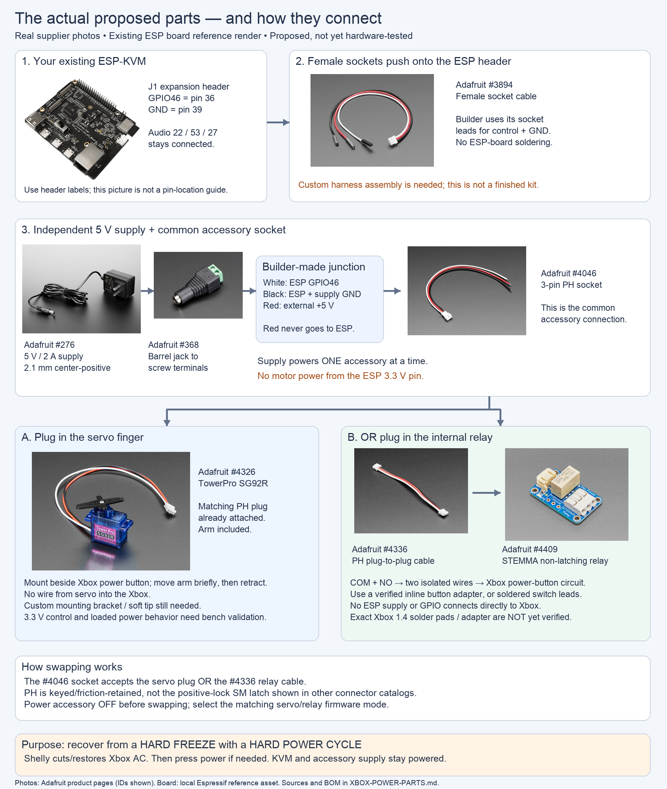

<!-- SPDX-License-Identifier: Apache-2.0 -->
# Xbox power accessory: exact proposed parts and real product pictures

> **Current direction (2026-10-24):** the dedicated relay and plug-in Xbox adapter supersede the interchangeable servo/relay concept for permanent installation. See [the new photo diagram and wiring notes](XBOX-POWER-RELAY-SETUP.md). Earlier material below is retained as design history.

Selected 2026-10-21 for the interchangeable-accessory roadmap. Proposed parts,
not a tested kit. No purchases made. This selection supersedes the generic
servo/relay/connector placeholders in the earlier conceptual diagram. It also
replaces the earlier Adafruit 2895 relay proposal for this shared 5 V interface.

## Proposed bill of materials

| Qty | Exact product | Role / remaining checks |
| --- | --- | --- |
| Existing | Espressif ESP32-P4X-Function-EV-Board, local PCB v1.6 / rev3.2 notes | GPIO46 J1-36 control and GND J1-39; verify identity/effective claims |
| 1 | [Adafruit 4326: TowerPro SG92R with JST PH cable](https://www.adafruit.com/product/4326) | Positional servo and included horn; use this connector variant, not ordinary 169 |
| 1 | [Adafruit 4409: STEMMA non-latching mini relay](https://www.adafruit.com/product/4409) | Assembled driver; 3-5 V power and control per guide; use COM/NO, leave NC unconnected |
| 1 | [Adafruit 4336: PH 3-pin plug-plug cable, 100 mm](https://www.adafruit.com/product/4336) | Source socket to relay's onboard socket |
| 1 | [Adafruit 4046: PH 3-pin socket pigtail, 200 mm](https://www.adafruit.com/product/4046) | Common source socket: accepts servo plug or relay cable |
| 1 | [Adafruit 3894: PH to individual female socket leads, 200 mm](https://www.adafruit.com/product/3894) | Builder can use female socket-ended leads as material for the ESP side; not a directly mating source harness as sold |
| 1 | [Adafruit 276: regulated 5 V / 2 A barrel supply](https://www.adafruit.com/product/276) | Independent accessory power; center-positive 2.1 mm; qualify servo transients/stall behavior |
| 1 | [Adafruit 368: 2.1 mm female barrel to screw terminal](https://www.adafruit.com/product/368) | Connects supply to builder-made power/ground junction |
| Custom | Servo bracket, soft contact tip, source harness junction, insulation/enclosure, strain relief | Not yet an exact purchasable Xbox-fit assembly |
| Custom | Two-wire relay contact lead and revision-1.4 inline power-button adapter, or installer-fitted switch leads | No verified current assembled adapter or actual solder-pad map |

The photo assets depict these actual catalog products. The existing board image
is a repository reference render, not a photograph of the owner's assembled rig.
They are scaled to fit the diagram, not to a common physical scale.

Stock is not guaranteed: direct product-page checks showed the **4326 servo and
276 supply out of stock**. Other pages/search snapshots disagreed on some cable
stock; check the exact SKU at order time. Distributor links exist on the pages,
but distributor inventory was not verified. Do not buy the standard servo 169
assuming its connector is the same as 4326.

## Exact proposed connection flow

A builder assembles the common source harness:

- White/control circuit: ESP GPIO46 (J1 physical 36) to #4046 signal contact.
- Black/ground circuit: ESP GND (J1 physical 39), supply negative and #4046 ground
  contact are joined securely.
- Red/supply circuit: #368 positive terminal to #4046 power contact. This supply
  does not connect to ESP 3V3 or board 5 V. Verify polarity using a meter.
- #3894 supplies socket-ended material for the first two connections; its stock
  PH plug is not needed once the builder makes the #4046 source harness.
- Add a reviewed external control pull-down (10k proposed), and ensure servo
  firmware initializes inactive and handles mode switching safely.

Assemble/insulate the junction properly; loose twisted wires or several leads
forced under one unsuitable terminal are not a finished harness. Wire sizes,
connector current capacity and supply behavior must support the measured servo
load. Have the builder produce a ready-to-plug assembly if no owner soldering
is desired. The photos of separate pieces do not imply this assembly is sold
as a finished unit.

**Servo:** plug #4326 directly into the #4046 common socket. Black/red/white are
ground/supply/signal per its product page. Servo responds to position pulses,
not the existing ATX GPIO on/off commands. Manufacturer demonstrates use with
3.3 V MCU boards, but no minimum input-high threshold or stall-current guarantee
was established here: bench-test the actual ESP signal and loaded 5 V supply.
The included horn needs a bracket to become a button finger; it is not a full
robot arm or a ready-mounted Xbox pusher.

**Relay:** unplug the servo; plug #4336 into #4046 and the relay's onboard PH
socket. Driver signal is white, supply red and ground black. Only the isolated
COM/NO contacts go to the Xbox button circuit through the two-wire lead. The
relay's clamp connector accepts 24-18 AWG per the guide. Validate low-current
button switching and open/release behavior on the received module.

The PH connector is keyed and removable, but does not provide the same positive
release latch as a JST SM cable set. We selected PH here to use the actual servo
and relay connectors with fewer custom adapters. **Adafruit 1663 SM cables were
researched but are not part of this BOM.** If a positive-lock quick-release is
mandatory, a builder can add that as another interface after reviewing current
rating and pin mapping.

Firmware must distinguish servo/relay modes. Disable accessory power before
swapping. No automatic accessory identification or safe hot-swap behavior is
implemented. Normal audio GPIO22/53/27 wiring stays installed.

## Remaining Xbox-specific gaps

The drawing ends at the Xbox power-button circuit deliberately: revision 1.4 is
owner-reported, but no exact solder points or assembled inline adapter have
been verified. A product photo of a generic motherboard would not resolve that.
Do not solder to the Xbox using this image.

The separate GPIO48 isolated switched-rail sensor is not included in this
button-accessory BOM. Neither the relay nor servo provides confirmation that
the Xbox booted. The original recovery constraints still apply: externally
cycle Xbox AC, verify restore and fresh power state, then press once if needed;
never blindly retry a toggle after an API timeout.

## Image provenance

Product photographs are downloaded from the official Adafruit product pages
linked above. Original photo URLs are recorded in
[product-photos/sources.json](roadmap-assets/product-photos/sources.json).
Supplier photos retain their original ownership; this diagram is project
reference material, not a claim to own those photographs or evidence of an
assembled/tested installation. No AI-generated product pictures are used.

Source board render:
[repository reference](docs/esp32-p4x-function-ev-board-isometric_v1.6.png).

Generation/layout source:
[draw_xbox_power_photos.py](roadmap-assets/draw_xbox_power_photos.py).

[Roadmap](XBOX-POWER-ROADMAP.md) ·
[Detailed investigation](docs/XBOX-POWER-CONTROL.md) ·
[Installer worksheet and builder contacts](docs/XBOX-POWER-INSTALL.md)
