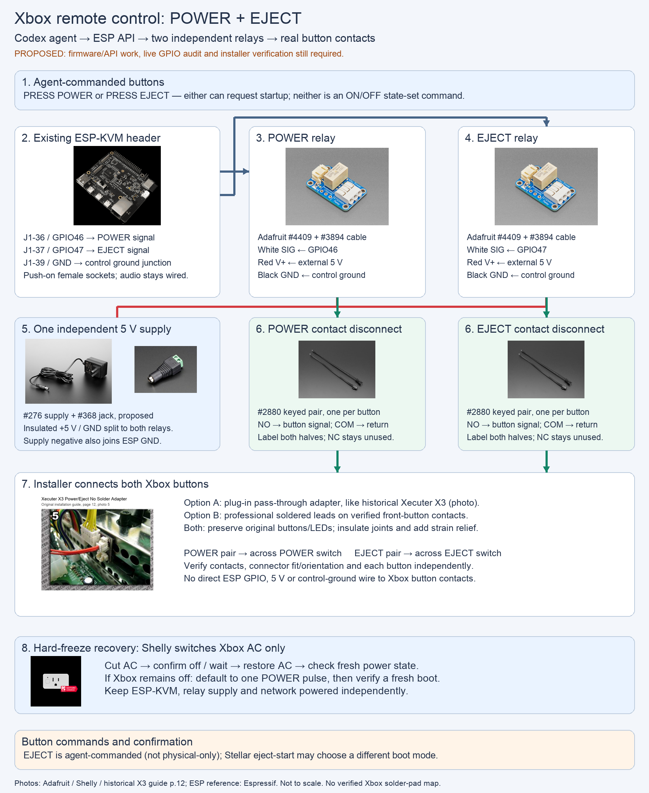

<!-- SPDX-License-Identifier: Apache-2.0 -->
# Proposed setup: agent-commanded Xbox POWER and EJECT

Preferred approach: reuse the [XWiFi button technique](docs/XBOX-XWIFI-BUTTONS.md)
in our existing ESP-KVM, with isolated contacts rather than bare GPIO wiring.
No extra Pico, internal Wi-Fi MCU, XERC or IR emitter is needed.

Both buttons are in scope. Codex can command the ESP to **press POWER** or
**press EJECT**, including deliberately starting the Xbox with either button.
"Agent-commanded" does not mean someone must physically press the console.
Firmware/API support is planned, not implemented or validated by this document.

## Connections and quantities

| Connection | Planned wiring |
| --- | --- |
| POWER control | ESP J1-36 / GPIO46 -> white SIG on POWER relay cable |
| EJECT control | ESP J1-37 / GPIO47 -> white SIG on EJECT relay cable |
| Control ground | ESP J1-39 -> both black relay wires and external supply negative |
| Relay power | One independent regulated 5 V supply -> both red V+ wires |
| POWER contacts | POWER relay NO/COM -> verified Xbox POWER signal/return |
| EJECT contacts | EJECT relay NO/COM -> verified Xbox EJECT signal/return |

Use **two #4409 relay boards, two #3894 control cables and two #2880 disconnect
pairs**. Label identical connectors POWER/EJECT. The builder makes insulated,
strain-relieved power/ground junctions; do not stack loose sockets on one pin.
The ESP end uses push-on female sockets. Existing audio GPIO22/53/27 stays wired.
The proposed GPIOs and header positions require final board/live pin verification.

Only relay NO/COM contacts go to the Xbox; leave NC unused. Do not add a direct
Xbox-button connection to ESP GPIO, control ground or 5 V. Existing HDMI/USB
may already join system grounds elsewhere; this is not whole-rig isolation.
The relay supply stays independent of switched Xbox AC. Verify supply polarity,
current headroom with both channels active, reset behavior and backfeed.

## Why it can start after Xbox AC returns

The KVM and one shared 5 V relay supply remain powered independently. The Xbox
PSU restores its own standby circuit after AC returns; that circuit responds to
POWER without the Xbox OS running. Wait for confirmed restoration and qualified
standby readiness, then pulse only if fresh evidence says the console is off.
The ESP supplies no Xbox power and draws no accessory current from Xbox standby.
A failed standby supply cannot be fixed by repeatedly pressing POWER.

## Xbox installation: either approach is acceptable

- **Plug-in:** pass all original front-panel circuits through an inline adapter,
  and tap POWER/EJECT separately in parallel with their physical switches.
- **Professionally soldered:** attach leads across verified POWER/EJECT contacts,
  preferably on the front button board; insulate joints, add strain relief and
  route to keyed disconnects. Removal requires desoldering.

Both preserve factory buttons and LEDs. The [short installer build request](XBOX-POWER-ADAPTER-BUILD-BRIEF.md)
includes the [historical Xecuter adapter reference](https://connortumbleson.com/uploads/2024/03/x3_ce_v10_v16.pdf#page=12).
Its photo shows topology, not a verified new harness or solder map. The reported
J2G2 pinout and candidate JST family still require physical fit, orientation and
continuity checks. Verify each button independently; never join their signals.

## Agent commands and freeze recovery

The planned API must expose separate bounded **PRESS POWER** and **PRESS EJECT**
operations, usable by Codex. These emulate buttons, not "set console ON" commands:
check fresh state first, because pressing an already-on console can have another
effect. Eject-start may select a different Stellar boot mode; qualify both paths.

The default automatic hard-freeze sequence uses Shelly explicit OFF/ON, confirmed
restoration and fresh power evidence, then one POWER pulse only if still off.
EJECT remains available for deliberate agent requests; exclude it from that
default sequence. Never blindly replay either button after a timeout.

Firmware must validate both pins, idle both outputs safely, bound release,
serialize button operations, deduplicate requests and report accepted versus
completed status. Add explicit EJECT semantics rather than assuming PC RESET or
long-hold behavior. Reconcile state after restarts. Hardware release guarantees
and stuck-active behavior still need qualification.

Calibrate Shelly standby/running bands before using watts as power evidence;
stale or ambiguous means UNKNOWN and inhibits a recovery press. Plug output ON
alone does not prove downstream AC. Reserve GPIO48 for isolated rail sensing if
needed. Require a fresh boot progression and useful response to verify liveness;
watts, LEDs, HDMI lock or ping alone are insufficient.

[Detailed investigation and implementation plan](docs/XBOX-POWER-CONTROL.md).

## Parts and photo sources

| Item | Exact proposed product / source |
| --- | --- |
| ESP board | Existing P4X; [local reference render](docs/esp32-p4x-function-ev-board-isometric_v1.6.png) |
| Control cables (2) | [Adafruit #3894](https://www.adafruit.com/product/3894) |
| Relays (2) | [Adafruit #4409](https://www.adafruit.com/product/4409) |
| Contact disconnects (2 pairs) | [Adafruit #2880](https://www.adafruit.com/product/2880) |
| External supply | [Adafruit #276](https://www.adafruit.com/product/276), proposed pending availability |
| DC jack termination | [Adafruit #368](https://www.adafruit.com/product/368) |
| AC switch | [Shelly Plug US Gen4](https://us.shelly.com/products/shelly-plug-us-gen4-white), S4PL-00116US |
| Historical adapter picture | [X3 CE guide page 12, photo 5](https://connortumbleson.com/uploads/2024/03/x3_ce_v10_v16.pdf#page=12) |
| Xbox interposer | Custom; connector parts and as-built wiring require verification |

Real supplier photographs remain credited to their respective owners. The ESP
image is a reference render. The Xbox image is a historical installation crop.
No photo of a proposed custom assembly is fabricated. Images are not to scale.
Original product-image URLs are recorded in
[the photo manifest](roadmap-assets/product-photos/sources.json).

[Diagram layout source](roadmap-assets/draw_xbox_relay_setup.py) ·
[Roadmap](XBOX-POWER-ROADMAP.md) ·
[Previous interchangeable concept, historical](XBOX-POWER-PARTS.md)

## Live configuration validation

[2026-10-27 read-only validation and remaining hardware tests](docs/XBOX-BUTTON-VALIDATION-2026-10-27.md):
the running KVM saves button GPIO46/47 with ATX disabled, and reports neither
in its fixed peripheral reservations. Pin choice is supported; electrical behavior,
physical switch points and complete recovery still require bench qualification.
