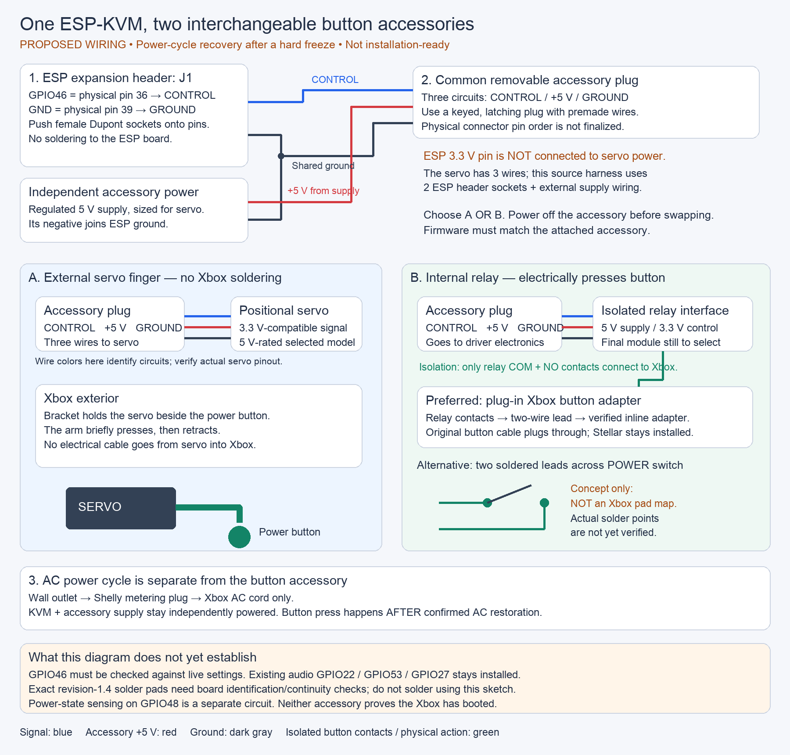

<!-- SPDX-License-Identifier: Apache-2.0 -->
# Roadmap: interchangeable Xbox power-button accessories

> **Current direction (2026-10-24):** the dedicated relay and plug-in Xbox adapter supersede the interchangeable servo/relay concept for permanent installation. See [the new photo diagram and wiring notes](XBOX-POWER-RELAY-SETUP.md). Earlier material below is retained as design history.


Updated: 2026-10-21. Status: proposed; no hardware purchased, firmware changed,
or live settings changed by this roadmap work.

**Exact-parts follow-up:** see [the proposed BOM with real supplier photos](XBOX-POWER-PARTS.md). It selects a PH-connector SG92R servo, assembled STEMMA relay and matching cables, superseding the generic component placeholders below. Custom harness assembly, the Xbox adapter and bracket remain unresolved.


## Why this is worth doing

The purpose of this work is to recover the Xbox from a **genuine hard freeze**
with a **hard power cycle**: cut AC power, wait for power to drain, restore AC,
and, if the Xbox remains off, press its physical power button so it boots again.
A frozen console may no longer respond to software commands. Restoring AC alone
may leave it sitting off, which is why the remotely controlled button accessory
is part of the recovery path.

The wiring, connector and firmware work is worthwhile because it can eliminate
the need to be physically present to unplug and restart a frozen Xbox. Reliable
recovery would let remote testing resume after a freeze. This is a proposed
capability, not one that has passed hardware acceptance yet.

This roadmap is for **hard power-cycle recovery after a hard freeze**. A reset
command or button press alone does not establish that power was removed.

## What we want

Use the existing ESP-KVM to complete that recovery after an externally controlled
AC power cycle. Give the ESP a removable accessory connection so the owner can
choose either:

1. An external servo finger that physically presses the Xbox power button.
   No internal Xbox modification is needed for the button press.
2. An isolated relay that electrically presses the same button using internal
   wiring, preferably a plug-in adapter rather than soldering to Xbox boards.

This is a small single-axis finger, not a general-purpose robot arm. Reuse the
existing ESP-KVM rather than adding another controller unnecessarily. Commands
arrive over the KVM's network connection (Ethernet primary, Wi-Fi fallback).
Servo PWM support is not implemented in this firmware yet.

## Existing hardware and audio wiring

The owner's Xbox is revision **1.4**, with a Stellar modchip. Local notes identify
the KVM as an Espressif Function EV / P4X board, PCB v1.6, silicon rev 3.2, with
C6 radio, Geekworm C790 HDMI capture, and Waveshare 3.5-inch DSI display.
Physical identity and effective saved settings still need installation checks;
older repo documentation also describes a different Waveshare P4-ETH rig.

| Function | ESP GPIO | J1 physical pin | Disposition |
| --- | --- | --- | --- |
| Existing audio BCLK | 22 | 12 | Keep installed |
| Existing audio WS | 53 | 35 | Keep installed |
| Existing audio DIN | 27 | 38 | Keep installed |
| Proposed interchangeable accessory control | 46 | 36 | Separate from audio; verify saved claims |
| Optional isolated power-state sensing | 48 | 33 | Separate from audio; verify saved claims |
| Existing audio ground | GND | 34 | Can share electrically through secure distribution |
| Unused reset default | 47 | 37 | Leave unwired; optional-reset firmware fix needed |

GPIO46 is the proposed shared control pin, not physical header pin 46.
There are other header ground positions, so audio occupying one GND does not
exhaust ground access. Do not stack loose jumpers or disconnect working audio.
GPIO46/48 looked clear in the audited audio build, but runtime claims and the
matching PCB schematic remain unverified. Do not interpret this table as final
installation clearance.

## Connector concept



The diagram uses **two ESP header connections** (GPIO46 and GND) plus a
separate 5 V supply feeding the three-wire accessory socket. This is the
preferred power layout for investigation; the earlier three-ESP-lead concept
is not a requirement. J1 pin 39 is a candidate ground so the existing audio
ground at pin 34 can remain installed. The soldered-switch drawing is only
a circuit symbol: actual Xbox revision-1.4 solder pads are still unverified.


The owner wants three push-on connections at the ESP, feeding a common cable,
with interchangeable accessories at the other end:

```text
Existing ESP-KVM
    GPIO46 control -----+
    KVM ground ---------+--- keyed accessory connection ---+--- servo finger
    accessory power ----+                                 |
                                                          +--- isolated relay
                                                   (one accessory at a time)

Optional GPIO48 + sensing connections remain separate.
```

Female **Dupont jumper sockets** slide onto the ESP's existing header pins;
they do not require soldering to the ESP. Standard single-pin Dupont sockets
are friction-fit and do not latch. For the frequently swapped connection, use
an explicitly selected **keyed, latching three-pin connector** with premade
pigtails. JST is a manufacturer with multiple incompatible connector families,
not an exact connector specification. Choose family, polarity, current rating,
wire gauge, strain relief and mating halves together before ordering.

Logical accessory signals are CONTROL, GND, and accessory supply. A common
**5 V accessory supply** is the proposed direction, so the final relay interface
must accept that supply and a 3.3 V GPIO control signal. Connector pin order is
**not assigned yet**. Label it once finalized; never depend on wire colors.

The ESP board's 5 V header has **not** been approved to power a servo. Prefer a
suitably rated independent regulated servo supply, sharing its ground with the
ESP while keeping positive supplies correctly separated. This can still appear
as a three-wire accessory socket: the supply branches into the harness rather
than necessarily coming from the ESP header. Do not backfeed USB/board power.
Servo starting/stall current, supply capacity and connector ratings must be
measured or verified from the chosen servo's specifications.

The two accessories have different electrical control requirements:

- Relay: GPIO high briefly energizes the isolated switch; low releases it.
- Servo: position-control pulses move the finger between retracted and pressed.

They require explicit firmware modes. A keyed connector prevents reversal but
cannot distinguish which accessory is attached. The three-wire concept has no
automatic accessory identification. Disable output and remove accessory power
before swapping, select the correct mode, then reconnect/enable. Do not call
this a hot-swap interface or assume it is safe in the wrong mode.

## Preliminary bill of materials

This is a functional shopping checklist, not a fully qualified order list.
Final servo, supply, relay interface and connector part numbers remain to be
selected together. Ask a builder for preassembled, labeled and tested cables
if the owner is to do no soldering at all.

| Quantity | Part | Notes |
| --- | --- | --- |
| 3 initially | Female Dupont jumper leads | ESP-side control/ground/power concept; final power lead may instead branch from external supply |
| 1 common socket + 2 mating accessory plugs | Keyed latching three-position connector, premade pigtails | Two mating sets can provide these halves plus a spare; choose exact family and current rating |
| 1 | Small positional servo with horn/short arm | Not a continuous-rotation servo; torque/travel and electrical compatibility to be selected |
| 1 | Adjustable bracket and compliant button-contact tip | Align with recessed Xbox power button without pressing eject or blocking manual access |
| 1 | Regulated servo supply and suitable power wiring | Independently powered; size for stall/start current |
| 1 | Isolated normally-open relay interface | Must match common accessory supply and 3.3 V control; external inactive bias |
| 1 | Insulated two-conductor button cable | Relay contacts to verified button signal/return; never ESP directly to Xbox |
| 1 | Xbox power/eject inline breakout and mating lead | Preferred solderless Xbox connection; assembled supply not yet found |
| As needed | Insulation, enclosure, mounting and strain relief | Secure all removable wiring |
| Optional | Isolated switched-rail sensing circuit and harness | Additional GPIO48 connection; not included in three-wire button accessory |
| Optional | Shelly Plug US Gen4, S4PL-00116US | Proposed Xbox-only AC switch; KVM stays independently powered |

The earlier internal-only design chose Adafruit **2895** with a **3.3 V** supply.
Do **not** connect that proposal to the new common 5 V socket unchanged.
Requalify its supply requirements or choose a suitable alternative/regulated
interface. A relay module's coil voltage, supply voltage and logic threshold
are distinct specifications. Never drive a bare relay coil from a GPIO.

For reference, the earlier sensor design uses Vishay **VO617A-3**, two 10k
resistors across the overall relay/sensor design, a 750-ohm LED resistor for a
verified switched 5 V rail, a 1N4148 protection diode and 10 nF filter capacitor.
See the installer worksheet for exact proposed part numbers and measurements.
The sensor is optional for manual pressing, but reliable automated recovery
needs fresh power-state evidence. Neither servo position nor relay completion
proves the console booted.

## Solder-free installation options and builder leads

A historical **Xecuter X3 Power/Eject No Solder Adapter** plugs into the existing
front-button cable path. Its guide covers revisions 1.0-1.6, including 1.4.
Its suitability as a relay breakout still needs circuit/pinout verification.
It does not require replacing Stellar with an X3. A current assembled adapter
with mating cable has not been found. The OSH Park reproduction is a bare PCB,
not a ready-to-install assembly.

For sensing, a hard-drive LP4/Molex splitter and a premade isolated sensor lead
could avoid motherboard solder points. Actual switched 5 V behavior, connector
pinout, fit and existing drive adapter arrangement must be checked. Do not
connect the 12 V wire to the proposed 5 V sensor circuit.

Candidate builders, neither contacted nor confirmed for this custom job:

- **TK's Custom Super Modz / Tony Kuberka:**
  `TKsCustomSuperModz@gmail.com`.
  [Official contact](https://tkscustomsupermodz.com/policies/contact-information).
  Relevant Xbox power-control assembly/testing experience; some shop paths
  were password-restricted. Do not buy the solder-required XERC as this adapter.
- **ModzvilleUSA:** `modzvilleusa@proton.me`.
  [Service inquiries](https://modzvilleusa.com/pages/send-in-services).
  Relevant Xbox harness/PCB work; custom kit willingness and pricing unknown.

Request a complete assembled interface, including the relay/sensor electronics,
not just loose cables. Require no cutting/soldering of original Xbox wiring,
labeled mating plugs, continuity/function tests and revision-1.4 installation
photos. Ask whether they can test on their own Xbox or require the owner's.
Detailed unsent inquiry text is in the installer worksheet linked below.

A ready-made external alternative is **SwitchBot Bot**, but it uses Bluetooth;
Wi-Fi access requires a hub or suitable Bluetooth controller integration. It is
not a wired ESP servo accessory. The recessed Xbox button still needs mounting
and travel validation. The direct servo concept is the preferred route to
investigate for one common ESP accessory port.

## Firmware and recovery work

The existing `components/kvm_atx` pulses outputs but has not been hardware
validated. It currently requires both power and reset pins, queues duplicate
requests, reports queued acceptance as success, and reads raw sense state
without debounce/freshness. No existing servo mode is claimed.

Implementation should provide:

- Explicit disabled/relay/servo mode; safe idle initialization, no movement or
  button closure at boot, reconnect, mode change or reset.
- Optional reset pin (-1), pin validation including saved settings and compiled
  audio exclusions, and a clear effective pin/status report.
- Servo calibration for retracted/pressed positions and travel limits; a timed
  press/retract sequence with tested load behavior. Loss of PWM/power does not
  inherently guarantee mechanical retraction: design and test that failure case.
- Single in-flight operation, duplicate-request protection, busy reporting,
  operation IDs and completed/released status. A timeout must never blindly
  trigger another button press.
- Separate sensing state with debounce, timestamps, freshness and unknown/fault
  handling. Rail ON means powered, not application alive; HDMI, ping and the
  programmable front LED are not definitive freeze/liveness signals.
- Confirmed AC OFF and restore, fresh OFF check before press, bounded attempts,
  cooldowns, persistent recovery journal and restart reconciliation.

Use short presses only until actual Xbox behavior is validated. Do not assume
PC-style long-press hard shutdown. A pull-down does not release an actively
stuck-high output; a servo can also jam against a button. Document the chosen
release guarantee and qualify a hardware limiter or mechanical return if needed.

## Next steps and acceptance

1. Select an actual positional servo, bracket and power supply. Verify GPIO
   signal compatibility, torque, travel, starting/stall current and clearance.
2. Finalize one connector pinout and a compatible 5 V relay accessory design.
   Scope boot/reset behavior before attaching anything to the Xbox.
3. Obtain a quote for a complete plug-only internal harness and optional sensor.
4. Implement and bench-test firmware modes and operation reliability without
   flashing or changing live hardware until separately authorized.
5. Test the external finger with conservative travel and verify release and
   manual button access. Verify correct-mode switching and power-off swaps.
6. Qualify the internal adapter's continuity/isolation and actual Xbox button
   signals before connecting. Verify the switched rail if adding sensing.
7. Test with capture, audio, display/touch, SD, Ethernet and Wi-Fi fallback active.
   No unintended press on reboot, no duplicate pulse after network timeout,
   and no loss of audio or other peripherals.
8. Only then perform supervised AC recovery trials, confirm boot independently,
   and decide whether unattended recovery is ready.

## Detailed investigation and sources

- [Firmware/hardware investigation and recovery state machine](docs/XBOX-POWER-CONTROL.md)
- [Installer worksheet, parts and builder inquiry](docs/XBOX-POWER-INSTALL.md)
- [Verified local audio wiring](docs/HDMI-AUDIO.md)
- [Xbox rig notes](docs/XBOX-RIG-DETAILS.md)
- [Espressif P4X J1 mapping](https://docs.espressif.com/projects/esp-dev-kits/en/latest/esp32p4/esp32-p4x-function-ev-board/user_guide.html)
- [Original X3 adapter installation guide, page 12](https://consolemods.org/wiki/images/5/5e/X3ce.pdf)
- [Bare X3 adapter reproduction PCB](https://oshpark.com/shared_projects/q30n1XCY)
- [Servo control background](https://esphome.io/components/servo/)
- [SwitchBot Bot](https://uk.switch-bot.com/pages/switchbot-bot) and
  [official Bluetooth API](https://github.com/OpenWonderLabs/SwitchBotAPI-BLE)

Source-verified facts and prior local observations are identified in the detailed
investigation. This roadmap records the design direction agreed in conversation;
it does not establish a tested common accessory interface or final purchasing
specification.
