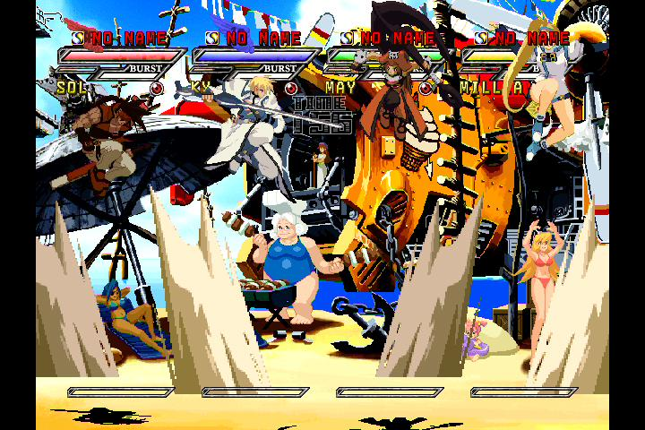

<!-- SPDX-License-Identifier: Apache-2.0 -->
# Four-player S3 routing and gameplay validation

**Current result (2026-10-25): all four routes passed actual four-player
Guilty Gear Isuka gameplay checks**, including separate crouches, analog-stick
movement, attacks and simultaneous jumps. The match finished paused with all
inputs neutral. The earlier provisioning and continuity results below remain
separate from the [gameplay validation](#actual-four-player-gameplay-2026-10-25).

On 2026-10-24, all four Waveshare ESP32-S3-Zero boards were provisioned with
home Wi-Fi and the preserved shared pairing key, connected to separate original
Xbox controller ports, and discovered by the upgraded ESP32-P4. The new boards'
factory flash was backed up locally before programming. S3 firmware remains
0.2.1; player assignment lives on the main P4 and does not depend on DHCP addresses.

| Player / physical port (operator connected) | S3 station MAC | Observed DHCP address |
| --- | --- | --- |
| 1 | ac:27:6e:b0:ce:a4 | 192.168.1.242 |
| 2 | d4:05:92:44:aa:94 | 192.168.1.243 |
| 3 | a0:f2:62:eb:f7:60 | 192.168.1.244 |
| 4 | ac:27:6e:b0:d5:d0 | 192.168.1.246 |

All new boards passed authenticated discovery, accepted neutral input, rejected
duplicate/reordered sequences, an incorrect receiver boot nonce, an altered
HMAC and an oversized packet, and expired the receiver lease. All flash regions
passed esptool hash verification. Player 4's watchdog reboot disconnected USB
before esptool finished restoring its serial settings; the subsequent successful
network boot and receiver tests confirmed that the application started.

## Main-to-Xbox checks

`test-four-players.mjs` used the authenticated, control-owned main `/ws` endpoint,
not direct input to the S3s. It checked all four receiver status endpoints and
Xbox USB host completion counters. The following checks passed:

- Neutral baseline and separate player 1/A, player 2/B, player 3/X, player 4/Y
  inputs, with the other three remaining neutral.
- Invalid player numbers 0, 5 and 255, and nonzero reserved XID bits ignored.
- Four simultaneous distinct held states, refreshed for more than 500 ms.
- Players 2..4 expiring while player 1 remained refreshed and held.
- Release-all clearing all four slots.
- Legacy 21-byte opcode 0x08 still addressing only player 1.
- Disconnecting the controlling session clearing all four slots.

| Controller | Xbox USB completions before | After |
| --- | ---: | ---: |
| 1 | 61686 | 62479 |
| 2 | 62189 | 62881 |
| 3 | 61402 | 62195 |
| 4 | 47159 | 47856 |

The first test attempt timed out fetching receiver status immediately after
startup; a subsequent complete run passed all checks. It is retained as an
incomplete attempt, not counted as a pass. All boards finished neutral.

A subsequent continuity check caught multi-second route gaps on players 2 and 4.
Main serial logs showed signed discovery being reacquired after lost beacons.
The initial sender stopped unicast output when a four-second announcement timer
expired. The corrected sender retains the authenticated learned address and
receiver boot nonce and keeps transmitting current state, including neutral
state after input expiry. Discovery still updates addresses/nonces and controls
the readiness indicator. The complete routing test above was repeated and passed
on the corrected firmware. A receiver at a reused IP cannot accept packets for
the paired MAC/boot nonce.

Opening the USB serial monitor also reset this P4 (`RESET_REASON_CORE_USB_UART`,
0x17), producing a separate expected startup interruption. Continuity sampling
was repeated over HTTP without opening serial. This must not be confused with
a routing panic.

The post-fix continuity check sampled each board 60 times over approximately
102 seconds. Players 1 and 3 had no observed lease expiry or status-request
failure. Player 2 had one sampled expired lease; player 4 had three sampled
expired leases and two HTTP request timeouts. The fix therefore removes the
discovery-based send cutoff but does not establish uninterrupted Wi-Fi delivery.
Physical repositioning of boards 2 and 4 was requested before retesting.
The isolated/simultaneous-input checks passed; long-term reliability remains
unresolved.

## Limits and reproduction

Xbox Controller Tool shows **Please remove all but one gamepad controller**
when multiple controllers are attached. Consequently this run verifies network
routing, per-board report state and USB completion on the real Xbox, but does
not visually verify four players in a game lobby or numeric analog values for
each additional board. Physical port numbers above follow the operator's cable
connections. The earlier [164-state player-1 sweep](S3-PLAYER1-VALIDATION.md)
remains the numeric/button display validation; it is not counted as four sweeps.
No four-player gameplay, long-duration latency test, precise synchronized
execution, rumble or OTA result is claimed.

Follow [setup and test instructions](../s3-dongle/README.md). Raw provisioning,
flash, boot and routing evidence is retained locally under ignored
`observations/four-player-20261024/`; private firmware/configuration files must
not be published. Saved pairing data migrates the original single-MAC format
without changing its key or player-1 identity. Five provisioning tests, host
regressions and both target builds passed. The main build retains existing
third-party Microlink warnings; no new routing warning was observed. Startup
logs also retain the known C6 version mismatch, LCD retry and old crash-dump
messages; this run showed no new panic or assertion.

Flashed application SHA-256:

- P4: `02338bf34afd57a4c3b985ee0335c0bf3f8db49430d6f4cbe8cd9fdf8254c8d4`
- S3 (players 2..4): `a9c5b10634263542cfbc6fd0d58cf79251af5977bef94b5dcf40aacdea5b19b8`

Player 1 retains its previously tested 0.2.1 firmware. Keyboard/touch/Bluetooth
continue to address player 1; slots 2..4 use the player-addressed raw command.
The browser console's readiness indicator still describes player 1.

## Repositioning follow-up: 2026-10-25

The operator moved boards 2 and 4 away from the Xbox metal case and separated
them while retaining their assigned USB ports. Firmware and pairing were unchanged.
All four receivers were online, USB-configured and neutral before the retest.

Ninety HTTP-only continuity samples per board spanned 94.5 seconds. All four
boards had zero observed expired routing leases and zero status-request failures.
This is a short sampled result; it does not prove that no packets were lost
between samples or establish long-session reliability.

The complete four-player routing test then passed again: isolated A/B/X/Y states,
four simultaneous distinct states, invalid-player/report rejection, independent
expiry, release-all, legacy player-1 input and disconnect release. All four
Xbox USB completion counters advanced.

| Controller | Xbox USB completions before | After |
| --- | ---: | ---: |
| 1 | 28081 | 28483 |
| 2 | 28106 | 28507 |
| 3 | 28123 | 28525 |
| 4 | 28116 | 28519 |

All four finished neutral. The Xbox had returned to XBMC, so the operator-authorized
routed player-1 inputs reopened Controller Tool before button testing. Its
single-controller display limitation remains; this was not a four-player gameplay
or per-player numeric analog display test. Evidence is retained under ignored
`observations/four-player-20261025/`. Keep the repositioned cable/board placement
for subsequent gameplay and longer stability tests.

## Actual four-player gameplay: 2026-10-25

Commands used the main P4's authenticated/control-owned `/ws`, with 22-byte
`[0x08, player, ...20 XID bytes]` messages. The four S3s stayed in their assigned
Xbox controller ports; no direct-to-S3 commands were used. The Xbox ran **Guilty
Gear Isuka**, **VS mode**, **May Beach** stage, with four human-controlled slots
and different characters/teams. Each additional controller joined separately
with its own Start command. The game's player-number flags provided visual
identity throughout the match.

| Routed player | Character | Independent crouch evidence |
| --- | --- | --- |
| 1 | Ky Kiske | [Only Ky crouched](assets/s3-four-player-isuka-p1.jpg) |
| 2 | Millia Rage | [Only Millia crouched](assets/s3-four-player-isuka-p2.jpg) |
| 3 | Sol Badguy | [Only Sol crouched](assets/s3-four-player-isuka-p3.jpg) |
| 4 | May | [Only May crouched](assets/s3-four-player-isuka-p4.jpg) |

Checks observed on the actual game display:

- Four separate Start commands joined the corresponding player slots.
- Each player selected its own character; the VS introduction explicitly showed
  the player/character mapping above. Match positions were chosen separately
  from controller numbers, so screen columns are not USB port numbers.
- A one-second Down hold sent to one player at a time made only its character
  crouch while the other three remained standing. Each returned to standing
  when released.
- Half-scale left-stick X (`-16384`, or `+16384` for player 3) moved each
  corresponding character horizontally. This checks analog input delivery;
  it does not establish proportional speed in this game's movement model.
- Individual attack inputs produced visible sword/hair/anchor actions. Sol and
  Millia were rechecked using slash/crouching-heavy inputs to capture clearer
  attack poses. The initial Sol heavy-attack snapshot was inconclusive and is
  not used alone as proof. May's attack also produced a visible counter-hit.
- Sending Up to all four players together put all four characters in the air
  in one screenshot. This was repeated after the movement/attack sequence.
- Normal release and session disconnect left every S3 reporting `held: -`.
  The Xbox host had consumed 61690 / 61526 / 61850 / 61748 reports respectively
  at the final check. The game was left paused, with neutral controller state.

A fresh live video viewer was used, and screenshots were captured during held
input rather than relying on cached stills. Actions were bounded to at most
1.4 seconds during gameplay and refreshed every 100 ms. The earlier protocol
isolation/expiry tests were not run blindly in game menus.

Launching the game switched capture from the 1280x720 XBMC dashboard to 720x480.
The main ESP restarted during this transition, briefly interrupting capture and
the control session. The session was reconnected before character selection.
The exact reset cause was not captured, so this is not claimed to be a clean
launch or attributed to the controller route. No further restart was observed
through gameplay; the final main uptime was 495 seconds with `crashDumpBytes: 0`.
This launch/capture issue remains a separate limitation.

Raw frames, the exact input journal (`commands.jsonl`) and final diagnostics are
retained locally under ignored `observations/four-player-gameplay-20261025/`.
The representative display evidence above is committed for review. The game
manual hosted by its distributor documents the VS/team model, but Xbox button
behavior and the results here were determined from the actual console display:
[Guilty Gear Isuka manual](https://shared.fastly.steamstatic.com/store_item_assets/steam/apps/267900/manuals/Guilty%20Gear%20Isuka%20PC%20Man.pdf).

This is a bounded real-game functionality test. It does not establish measured
end-to-end latency, frame-accurate synchronization, every analog magnitude on
all four controllers, long-session stability, rumble or OTA. The existing
[player-1 numeric sweep](S3-PLAYER1-VALIDATION.md) remains the precision test.
