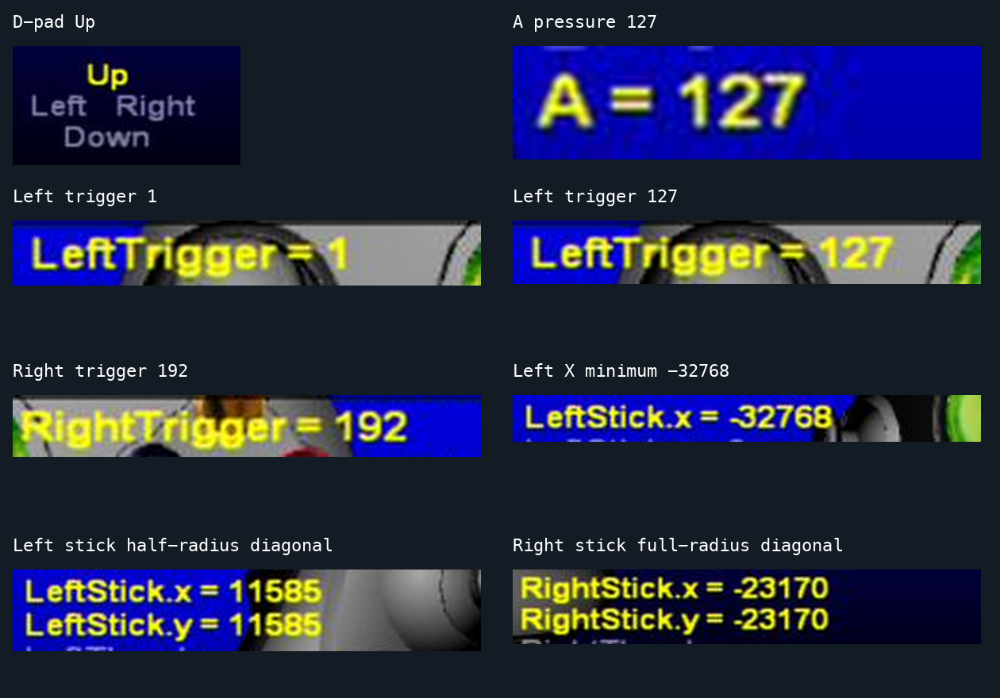

<!-- SPDX-License-Identifier: Apache-2.0 -->
# S3 player-1 hardware validation

**2026-10-24: all 164 sampled states passed on the real original Xbox.**
Commands traversed the main ESP32-P4, home Wi-Fi, Waveshare ESP32-S3-Zero,
USB adapter and physical controller port 1. Xbox Controller Tool's **Gamepad /
Control Test Page** displayed the expected numeric values and button highlights.
The other three boards have not been configured or validated.



## Coverage

| Category | States | What was checked |
| --- | ---: | --- |
| Digital buttons and releases | 16 | Up, Down, Left, Right, Start, Back, both stick clicks; each separately, then neutral |
| Pressure-sensitive buttons | 19 | A, B, X, Y, Black, White at 1, 127, 255; final neutral |
| Triggers | 17 | Each trigger independently at 0, 1, 32, 64, 127, 192, 254, 255; final neutral |
| Stick axes | 45 | Left/right X/Y independently at -32768, -24576, -16384, -8192, -1, 0, 1, 8192, 16384, 24576, 32767; final center |
| Circular stick motion | 64 | Each stick at radii 16384 and 32767, 16 angles per circle, 22.5 degrees apart; includes diagonals and negative quadrants |
| Combined analog state | 1 | LT=64, RT=192, LX=8192, LY=-16384, RX=-24576, RY=32767 simultaneously |
| Boundary neutral states | 2 | All controls neutral at start and finish |
| **Total** | **164** | **All sampled displayed states matched** |

Both trigger amounts and signed stick positions arrived without endpoint-only
quantization. Stick circles are sampled positions, not a measurement of physical
stick mechanics or infinite-resolution rotation. Pressure buttons and triggers
have eight-bit values; stick X/Y fields have signed 16-bit values.

Small stick values can remain gray in Controller Tool while the numeric readout
still shows the exact value, including +1 and -1. The tool's highlighting has a
deadzone; this test did not mistake gray text for a zero-valued input. There was
no observed numeric deadzone or unexpected sign inversion in these samples.

## Method and evidence

The automated sweep sent full XID state through authenticated/control-owned
main-ESP WebSocket opcode 0x08, refreshed every 100 ms. It held each state for
650 ms before saving a live screenshot, expected report bytes, timestamp and
S3 diagnostics. An active video viewer kept JPEG encoding current. USB host
completion counts increased throughout; a final neutral state was verified.

Local evidence is retained in ignored `observations/player1-full-sweep-20261024/`:
`plan.json`, 164 original JPEGs, `observations.jsonl`, reviewed
`display-analysis.json`, and firmware hashes. Numeric text was read with local
macOS Vision OCR and button highlights checked against the neutral frame.
150 states needed no OCR correction; the remaining 14 were visually checked
against enlarged crops of the original screenshots. Text overlapping the
rotating controller graphic and missing minus signs were OCR ambiguities,
not accepted input mismatches. Representative crops above are checked-in proof;
private build settings, complete device logs and firmware binaries are excluded.

Tested firmware SHA-256:

- P4: `b55fb7d31cc32247b20514134ea121c70bfa7972665ec058c9a45b4580120cdc`
- S3 0.2.1: `09b7fcf0d3983e7946192fd2eb0c3b4aa92a02c1e3e7e2b990c17294e6b9c565`

The later build cleanup shares the existing vendored USB wrapper through a
thin S3 shim. The standalone S3 build passed with the KVM storage class disabled;
all four wrapper object files had identical machine-code sections to the
hardware-tested S3 build. P4 defaults retain the storage class and were rebuilt
separately. The hashes above identify the actual images used for the sweep.

## Safety and protocol checks

The hardware checks also passed for malformed raw-report lengths, output-report
headers, reserved digital bits, explicit release, automatic stale-input expiry,
and controller-session disconnect release. A combined raw B/trigger/stick state
arrived, then returned to neutral after refresh stopped. The preceding signed
UDP probe verified valid neutral input, altered-HMAC rejection, duplicate and
reordered sequence rejection, prior-S3-boot rejection, oversized-packet rejection,
and receiver-lease expiry. The protocol authenticates traffic but does not encrypt
it; it is intended for the trusted home network.

During bring-up, a five-millisecond receiver wait rounded down to zero at the
100 Hz scheduler tick rate. S3 0.2.1 blocks at least one tick and runs the receiver
below USB priority. Host-completion counters and the visible Xbox test confirmed
that USB delivery works after that fix. Merely receiving Wi-Fi packets or having
a configured USB device was not treated as an end-to-end pass.

## Repeat and remaining limits

Follow [pairing/build instructions](../s3-dongle/README.md), open Controller Tool,
and run:

```sh
node s3-dongle/tools/sweep-player1.mjs http://esp.local http://S3_IP NEW_EVIDENCE_DIR
node s3-dongle/tools/test-raw-player1.mjs http://esp.local http://S3_IP
```

The sweep captures evidence; it does not automatically declare Xbox display
verification passed. Compare screenshots against the saved expected state,
reviewing uncertain OCR visually. Tests deliberately take control of the main
ESP's session and always release input on normal completion/error.

This establishes sampled player-1 input correctness. It does not establish
four-player operation, long-session/gameplay stability, sub-frame synchronization,
latency distributions, packet-loss performance, rumble, or physical-controller
pairing to the S3. Those remain separate tests before claiming a complete
four-player system.
